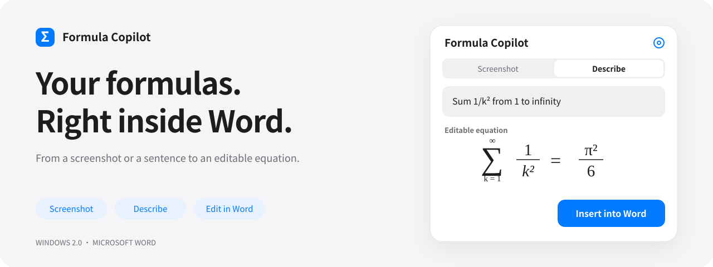
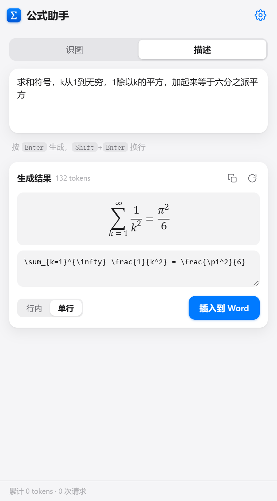
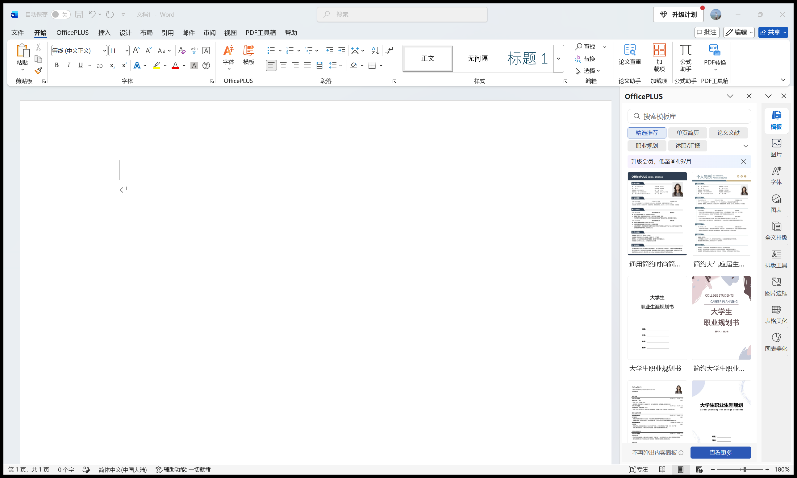

<div align="center">

<h1>Formula Copilot</h1>

<p>Turn a screenshot or a sentence into an editable equation in Word.</p>

<p>
  <a href="https://github.com/aNother1332/word-formula-copilot/releases/latest"></a>
  
  <a href="LICENSE"></a>
</p>

<picture>
  <source media="(prefers-color-scheme: dark)" srcset="docs/readme/hero-en-dark.svg" />
  
</picture>

<p>
  <strong><a href="https://github.com/aNother1332/word-formula-copilot/releases/latest/download/FormulaCopilot-Windows.zip">Download for Windows</a></strong>
  &nbsp; · &nbsp; <a href="#get-started-in-three-steps">Quick start</a>
  &nbsp; · &nbsp; <a href="README.md">简体中文</a>
</p>

<p><sub>Windows desktop Word · Bring your own API key · Open source; model usage is billed by your provider</sub></p>

</div>

---

## More writing. Less equation entry.

Fractions from a paper, sums from a lecture, subscripts from your notes. Capture what you see or describe what you mean, then preview and insert the result without leaving Word.

| Capture it | Describe it | Keep editing |
| :--- | :--- | :--- |
| Paste a screenshot, drag an image, or upload a file. Recognize a formula on its own, or transcribe surrounding text too. | Describe a formula in natural language and press Enter. Paste or edit LaTeX when you need finer control. | Insert an editable native Word equation. Continue changing its structure, symbols, and content in Word. |

<div align="center">
  
  <p><sub>Describe → preview → edit → insert. One pane for the whole flow. The current interface is in Chinese.</sub></p>
</div>

## Open Word. Find it on Home.

**Windows 2.0 uses a persistent native COM add-in.** Install once, then open Word from Start, a shortcut, or a document. The **Home → 公式助手** button is available in the document editor. Click it to open or hide the pane.

Daily use needs no custom launcher, background Node.js server, localhost certificate, or developer sideload. Each document window has its own pane and insertion target.



## Get started in three steps

1. **Download and extract** the [Windows package](https://github.com/aNother1332/word-formula-copilot/releases/latest/download/FormulaCopilot-Windows.zip).
2. **Save your work and close Word**, then double-click **`Install.cmd`**.
3. **Open Word normally**, create or open a document, click **Home → 公式助手**, and enter your model provider and API key in Settings.

The installer detects x86/x64 Word and installs for the current user. If WebView2 Runtime is missing, it downloads Microsoft's official bootstrapper and verifies its signature before installing it. Administrator rights are usually unnecessary.

Run `Repair.cmd` or `Uninstall.cmd` with Word closed. You can also uninstall through Windows Settings. Repair and uninstall retain personal settings. See the [installation guide](docs/INSTALL.md) for details.

> **Compatibility:** Windows 10/11 desktop Word. Tested on 64-bit Word `16.0.20430.20182`; x86 components are included but have not been tested on 32-bit Office. Word policies, disabled add-ins and hidden ribbon groups remain under user or administrator control. This package does not support WPS, Mac or Word Online.

## Your choice of model

Presets include **DeepSeek, Zhipu GLM, SiliconFlow, Alibaba Cloud Bailian, and OpenRouter**. You can also configure an OpenAI-compatible endpoint, with separate vision and text models. Availability depends on the provider.

Settings include connection and image-recognition tests, plus per-request, session and cumulative token usage. Images and descriptions go directly to your selected provider. API keys and preferences stay in the local WebView2 profile. Opening the pane does not insert diagnostic content into your document. Settings from the previous web add-in need to be entered again in the native edition.

<details>
<summary><strong>For developers: building, testing and architecture</strong></summary>

### Install from source

Run the root `Install.cmd`; missing release files are built automatically. Building needs desktop Office interop assemblies, the Windows .NET Framework compiler, and network access for the pinned WebView2 SDK. Neither the .NET SDK nor Node.js is required for end-user installation.

```powershell
npm install
npm test
npm run build:windows
npm run test:windows
npm run test:install
npm run test:api
```

The build produces `dist/FormulaCopilot-Windows.zip`. Word tests require the installed add-in and all Word windows closed. They invoke the real ribbon, check the pane, verify native OMath objects and document isolation, and close temporary documents without saving. They do not call paid model APIs. The separate API smoke test requires `DEEPSEEK_API_KEY`.

The Windows host uses COM, a custom task pane and WebView2. The shared UI is plain HTML/CSS/JavaScript. Conversion follows **LaTeX → Temml → MathML → OMML → Word**; mixed text and equations use WordprocessingML in a Flat OPC package. The CDP port is enabled only by the integration test environment.

See [native architecture and research](docs/native-architecture.md). Rebuild the README banners with `node scripts/build-readme-art.mjs`. The previous Office.js host remains available for development; see [the legacy guide](docs/legacy-web-addin.en.md).

</details>

---

<div align="center">

**Keep your attention on the content.**

[Download for Windows](https://github.com/aNother1332/word-formula-copilot/releases/latest/download/FormulaCopilot-Windows.zip) · [Report an issue](https://github.com/aNother1332/word-formula-copilot/issues) · [MIT License](LICENSE)

<sub>Temml · mathml2omml · Microsoft WebView2 · Microsoft Word</sub>

</div>
