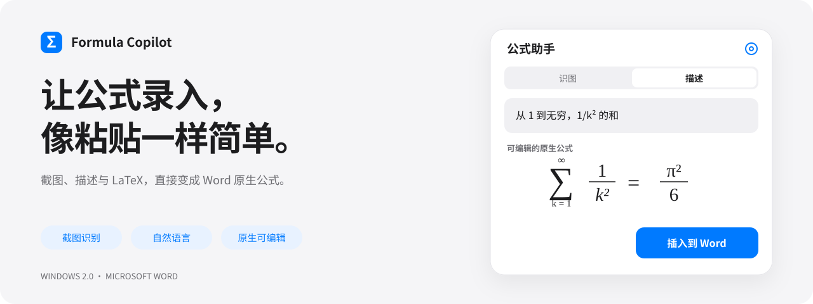
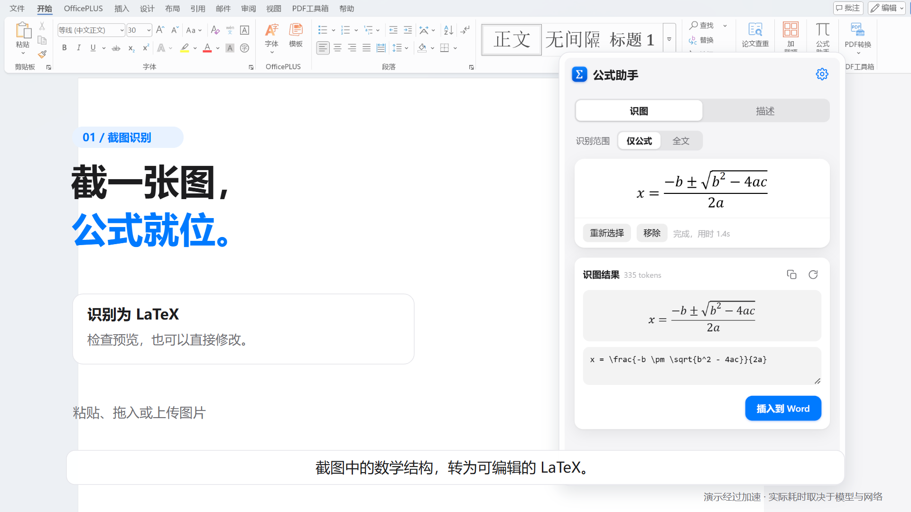

<div align="center">

<h1>公式助手 · Formula Copilot</h1>

<p>把截图和一句话，变成 Word 里可编辑的公式。</p>

<p>
  <a href="https://github.com/aNother1332/word-formula-copilot/releases/latest"></a>
  
  <a href="LICENSE"></a>
</p>

<picture>
  <source media="(prefers-color-scheme: dark)" srcset="docs/readme/hero-zh-dark.svg" />
  
</picture>

<p>
  <strong><a href="https://github.com/aNother1332/word-formula-copilot/releases/latest/download/FormulaCopilot-Windows.zip">下载 Windows 安装包</a></strong>
  &nbsp; · &nbsp; <a href="#30-秒了解公式助手">观看视频</a>
  &nbsp; · &nbsp; <a href="#三步开始使用">快速安装</a>
  &nbsp; · &nbsp; <a href="docs/INSTALL.md">使用与修复</a>
  &nbsp; · &nbsp; <a href="README.en.md">English</a>
</p>

<p><sub>适用于 Windows 桌面版 Microsoft Word · 自备模型 API Key · 开源免费，模型调用费用由服务商收取</sub></p>

</div>

---

## 30 秒了解公式助手

[](https://github.com/aNother1332/word-formula-copilot/blob/main/docs/media/Formula-Copilot-Promo-1080p60.mp4)

**[▶ 点击封面播放完整视频](https://github.com/aNother1332/word-formula-copilot/blob/main/docs/media/Formula-Copilot-Promo-1080p60.mp4)** · [下载 1080p / 60fps 成片](https://github.com/aNother1332/word-formula-copilot/releases/download/v2.0.0/Formula-Copilot-Promo-1080p60.mp4) · [中文字幕](docs/media/Formula-Copilot-Promo.zh-CN.srt)

25 秒功能演示 + 5 秒免责声明，配有节奏音乐与中文字幕，无配音。展示截图识别、文字描述生成公式，以及插入 Word 后继续编辑的流程；演示操作已加速。

<sub>本视频由 GPT6.1Sol 制作。非营利展示不当然构成合理使用；第三方素材版权归原权利人，使用须符合相应授权。</sub>

## 专注写作，让公式录入更轻松

论文里的分式、课件里的求和、笔记里的上下标——看到公式就截图，想到公式就描述。公式助手在 Word 侧边栏完成识别、预览和插入，帮你把时间留给正文。

<table>
<tr>
<td width="33%" valign="top">

### 截一张图

粘贴截图、拖入图片，或上传文件。选择“仅公式”识别一个式子，也可以选择“全文”，连同周围的文字一起转录。

</td>
<td width="33%" valign="top">

### 说一句话

用中文描述分数、求和、上下标。按下 Enter，查看公式预览；懂 LaTeX，也可以直接粘贴或修改源码。

</td>
<td width="33%" valign="top">

### 在 Word 里接着改

点击“插入到 Word”，得到可编辑的原生公式。之后仍能在 Word 中继续修改结构、符号与内容。

</td>
</tr>
</table>

## 从描述到公式，看得见，也改得动

<div align="center">
  
  <p><sub>描述 → 预览 → 编辑 → 插入。一个侧边栏，完成整段流程。</sub></p>
</div>

## Word 打开，公式助手就在“开始”里

**Windows 2.0 使用持久注册的原生加载项。** 安装一次后，从开始菜单启动 Word、使用快捷方式，或直接打开文档，都可以在编辑界面的 **开始 → 公式助手** 找到入口。点击打开右侧窗格，再次点击收起。

日常使用无需先运行启动脚本、后台 Node 服务或 localhost 证书。多个文档窗口各有自己的窗格，内容插入到对应文档。

<div align="center">
  
  <p><sub>本机真实截图：“文档1 - Word”的“开始”功能区右侧，可见 π 图标的“公式助手”。</sub></p>
</div>

## 三步开始使用

| 步骤 | 操作 |
| :--- | :--- |
| **01 · 下载解压** | 下载 [Windows 安装包](https://github.com/aNother1332/word-formula-copilot/releases/latest/download/FormulaCopilot-Windows.zip)，完整解压。 |
| **02 · 双击安装** | 保存文档、关闭所有 Word 窗口，然后运行 **`Install.cmd`**。 |
| **03 · 打开使用** | 正常打开 Word，新建或打开文档，点击 **开始 → 公式助手**，在设置中填写模型和 API Key。 |

安装器自动识别 Word 的 32/64 位，安装到当前用户目录；缺少 WebView2 Runtime 时，会验证并安装微软官方组件。通常不需要管理员权限。

**修复与卸载也有入口：** 关闭 Word 后运行 `Repair.cmd` 或 `Uninstall.cmd`。Windows“设置 → 应用”也可以卸载；修复和卸载均保留个人设置。更多说明见 [安装指南](docs/INSTALL.md)。

> **兼容性：** 面向 Windows 10/11 桌面版 Word。本机已验证 64 位 Word `16.0.20430.20182`；包含 x86 组件，32 位 Office 尚未实机验证。Word 禁用项目、组织策略和用户隐藏的功能区需要按[安装指南](docs/INSTALL.md)处理。WPS、Mac 和 Word 网页版不适用此安装包。

## 模型由你选择

| 服务商预设 | 可配置内容 |
| :--- | :--- |
| DeepSeek · 智谱 GLM · 硅基流动 · 阿里云百炼 · OpenRouter | 分别配置识图模型和文本模型 |
| 自定义 OpenAI 兼容接口 | 填写 API 地址、模型名称与 API Key |

设置中提供连接与识图能力测试，也能查看单次、会话和累计 Token 用量。预设模型的实际可用性以服务商为准。

**数据路径清楚：** 图片和描述直接发送给你配置的模型服务商，API Key 与设置保存在本机 WebView2 浏览器存储中。打开工具不会向文档写入测试内容。旧网页加载项升级到原生版后，需要重新填写一次设置。

<details>
<summary><strong>给开发者：构建、测试与实现</strong></summary>

### 从源码安装

双击仓库根目录的 `Install.cmd`，首次安装会自动编译缺失的发布文件。构建需要桌面 Office 的互操作程序集、Windows 自带的 .NET Framework 编译器，以及用于下载固定版本 WebView2 SDK 的网络连接。无需安装 .NET SDK；终端用户无需 Node.js。

### 开发命令

```powershell
npm install
npm test                  # 本地转换与消息桥回归测试
npm run build:windows     # 生成 dist/FormulaCopilot-Windows.zip
npm run test:windows      # 真实 Word 功能区、窗格、原生公式与多文档集成测试
npm run test:install      # 卸载、重装、修复与设置保留验收
npm run test:api          # 可选：付费 API 冒烟测试，需 DEEPSEEK_API_KEY
```

Word 集成测试前需安装原生版并关闭所有 Word 窗口。测试使用临时文档和本地生成内容，不调用付费模型 API；结束后关闭测试文档而不保存。测试专用的 WebView2 调试端口不会在日常启动时默认开启。

### 转换链路

```text
截图 / 自然语言 → 模型接口 → LaTeX
                               ↓
                         Temml → MathML → OMML
                               ↓
                    Word 原生接口 → 可编辑公式
```

Windows 宿主使用 COM、原生任务窗格和 WebView2；界面为 HTML/CSS/JavaScript。全文模式直接构造包含文字、段落与 OMML 的 WordprocessingML，经 Flat OPC 插入文档。

主要目录：`native/` 宿主、`src/` 界面、`scripts/` 构建安装、`test/` 验证。更多信息见 [宿主设计与调研](docs/native-architecture.md)。README 横幅可通过 `node scripts/build-readme-art.mjs` 重新生成。

原 Office.js 网页加载项保留作开发用途：`npm start` 与 `manifest.xml`；参见[旧版开发说明](docs/legacy-web-addin.md)。Windows 原生版日常使用无需侧载。

</details>

---

<div align="center">

**把公式交给助手，把注意力留给内容。**

[下载 Windows 版](https://github.com/aNother1332/word-formula-copilot/releases/latest/download/FormulaCopilot-Windows.zip) · [反馈问题](https://github.com/aNother1332/word-formula-copilot/issues) · [MIT License](LICENSE)

<sub>Temml · mathml2omml · Microsoft WebView2 · Microsoft Word</sub>

</div>
